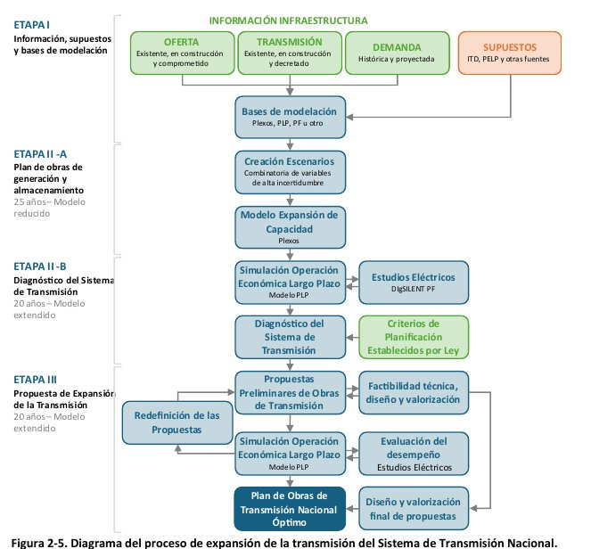
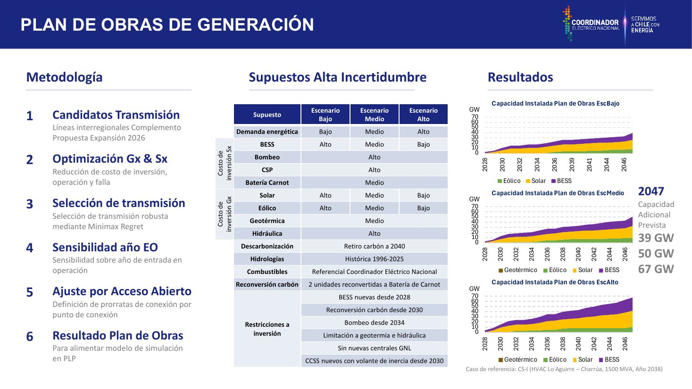
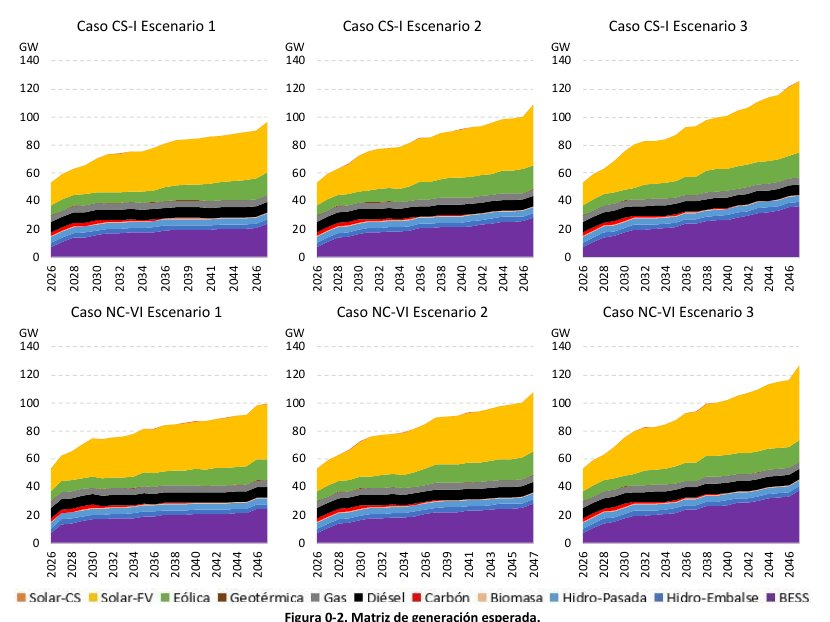
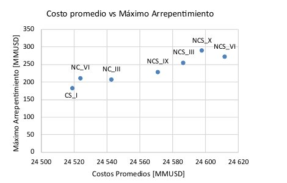
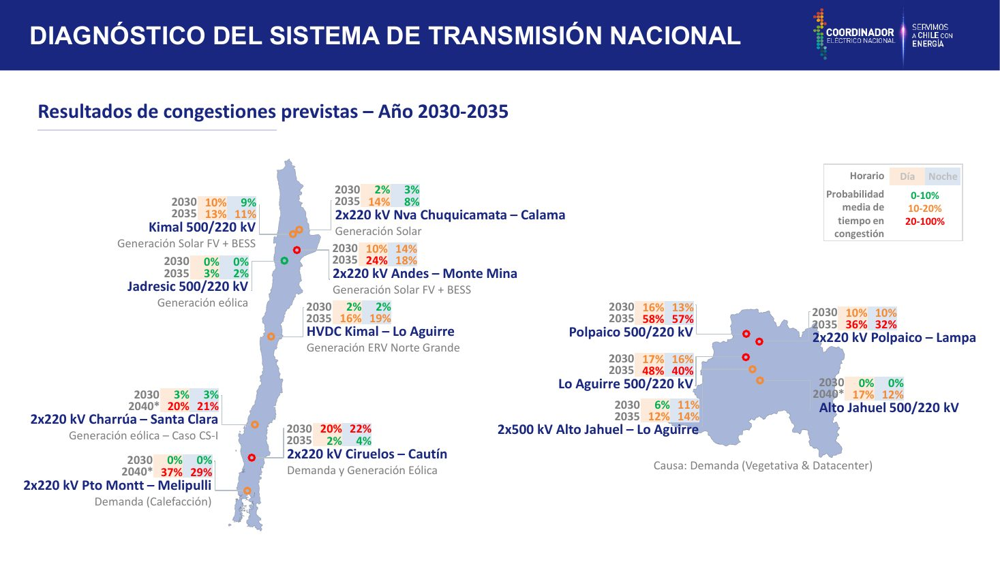
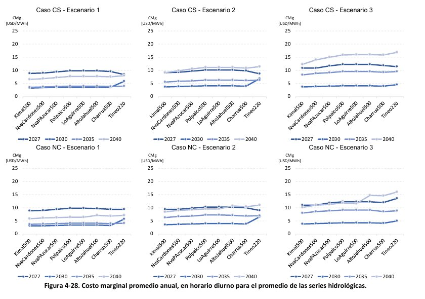

# PLP-PET27 — Proceso de Planificación de la Transmisión 2027

> [!WARNING]
> Provided **AS IS**, not validated by the publishers, who keep all
> rights over the data.  See the [disclaimer](../../../DISCLAIMER.md).

The **PLP** model bases the CEN used for the *Diagnóstico del uso
esperado del sistema de transmisión* of its **Propuesta de Expansión de
Transmisión del SEN 2027** (the annual transmission planning process of
Art. 87 of the Ley General de Servicios Eléctricos), converted to gtopt
with `plp2gtopt`.

One case per **energy scenario** of the planning process (low, medium,
high) in the reference transmission configuration **CS-I**, plus the
same cut of the CS-I entry-year sensitivity (`_sens`):

| Case | Scenario | PLP base (IPLP) | Generators | Batteries | Case content | LP rows (`--lp-only`) |
|---|---|---|---:|---:|---|---:|
| [e01](e01) | 1 — Bajo | `PET27_E01_CS_I_v4_d` | 933 | 158 | `pet27_e01_cs_i_1y`: first 12 stages, hydrology 1, no apertures | 470,429 |
| [e02](e02) | 2 — Medio | `PET27_E02_CS_I_v4_d` | 965 | 171 | `pet27_e02_cs_i_1y`: same cut | 475,577 |
| [e03](e03) | 3 — Alto | `PET27_E03_CS_I_v4_d` | 988 | 202 | `pet27_e03_cs_i_1y`: same cut | 487,853 |
| [e01_sens](e01_sens) | 1 — Bajo, CS_I_sens | `PET27_E01_CS_I_v4_d_sens` | 933 | 158 | `pet27_e01_cs_i_sens_1y`: same cut; `source/` holds only the files that differ from e01 | 469,469 |
| [e02_sens](e02_sens) | 2 — Medio, CS_I_sens | `PET27_E02_CS_I_v4_d_sens` | 965 | 171 | `pet27_e02_cs_i_sens_1y`: same cut; `source/` holds only the files that differ from e02 | 474,617 |
| [e03_sens](e03_sens) | 3 — Alto, CS_I_sens | `PET27_E03_CS_I_v4_d_sens` | 988 | 202 | `pet27_e03_cs_i_sens_1y`: same cut; `source/` holds only the files that differ from e03 | 486,893 |

The CS-I cases share the network (292 buses, 430 lines: the reduced SEN at
500 and 220 kV with some 154, 110 and 66 kV), 10 reservoirs with the Laja
and Maule irrigation agreements, 276 monthly stages (April 2026 to March
2049) of 8 blocks and 25 historical hydrologies.  The scenarios differ in
demand (E01 < E02 < E03), the generation plan of works (`plpcnfce.dat`,
`plpmance.dat`, `plpcenbat.dat`), block layout and inflow file.

```
plp_pet27/
├── README.md        this file: the process, scenarios, variants, what is (not) in the base
├── methodology/     CEN Anexo II "Metodología" (PDF, as published) and the
│                    CEN report figures and webinar slides used below (process, assumptions, published diagnosis results)
├── e01/ e02/ e03/   one case per energy scenario
│   ├── README.md    how to run, regeneration command, variants
│   ├── source/      PLP input files as published by the CEN (xz)
│   └── case/        the gtopt case converted from ../source (plp2gtopt)
├── e0N_sens/        CS-I entry-year sensitivity: source/ = mantlin.csv only (over ../e0N/source)
```

## The planning process

Every year the CEN prepares a proposal for the expansion of the national
and zonal transmission systems (PET, *Propuesta de Expansión de la
Transmisión*), which the Comisión Nacional de Energía then uses for its
annual transmission plan.  Its methodology ([Anexo II](methodology/Anexo-II-Metodologia.pdf))
has six stages: gathering information and modelling assumptions;
long-term studies; the **diagnosis of the expected use of the system**;
defining expansion proposals and their performance; their economic
evaluation; and the plan of transmission works.  The PET 2027 calendar:
technical workshop with industry (June 2026), period for industry
project proposals (August–September 2026), **diagnosis and industry
webinar (November 2026, these bases)**, preliminary report (December
2026), industry comments on it (December 2026) and the final PET 2027
(January 2027).

The Diagnóstico report summarises the national process in four stages
(Figura 2-5): **I** information, assumptions and modelling bases;
**II-A** the generation and storage plan of works (capacity-expansion
model, PLEXOS, 25 years, reduced network); **II-B** the diagnosis of the
transmission system (long-term operation with **PLP**, 20 years,
extended network, plus PowerFactory electrical studies) — the stage
these bases come from; and **III** the transmission proposals, iterated
with PLP simulations and technical / economic evaluation into the
optimal national plan of works.



*Source: Coordinador Eléctrico Nacional (CEN), “Diagnóstico del Uso Esperado del Sistema de Transmisión 2027” ([`Informe_Diagnostico_PET_2027-1.pdf`](https://www.coordinador.cl/wp-content/uploads/2026/11/Informe_Diagnostico_PET_2027-1.pdf), November 2026), Figura 2-5, p. 24.*

**1. Demand and generation scenarios.**  Demand is projected for
2026–2046 by combining a top-down econometric forecast with bottom-up
surveys of free and regulated customers, plus new consumption (green
hydrogen, electromobility, data centres, electrified heating): 2.5–3.5 %
a year nationally, monthly energy by sector for PLP.  The future
generation fleet is not taken as given: the CEN optimizes a joint
generation and transmission plan (*Optimización Gx & Sx*) under three
**high-uncertainty scenarios** (low, medium, high) that differ in demand
and in the investment costs of solar, wind and storage; all three keep
coal retirement by 2040, historical hydrology 1996–2025, the CEN's
reference fuels, no new LNG plants and new storage from 2028.  The
resulting plan of works (39, 50 and 67 GW of additional capacity by
2047, mostly solar PV + BESS in Antofagasta, then wind) is what feeds
PLP: in these bases it is the fixed set of future units of
`plpcnfce.dat` / `plpmance.dat`, not candidates.



*Source: Coordinador Eléctrico Nacional (CEN), webinar presentation “Diagnóstico del uso esperado del sistema de transmisión — Proceso de Planificación de la Transmisión 2027”, 16 November 2026, `20261116-PPT-Diagnostico_PET27_Webinar.pdf`, slide 5; [CEN publication of the Diagnóstico, 16 November 2026](https://www.coordinador.cl/novedades/coordinador-publica-diagnostico-que-proyecta-el-uso-del-sistema-de-transmision-entre-2027-y-2047/).*



*Source: Coordinador Eléctrico Nacional (CEN), “Diagnóstico del Uso Esperado del Sistema de Transmisión 2027” ([`Informe_Diagnostico_PET_2027-1.pdf`](https://www.coordinador.cl/wp-content/uploads/2026/11/Informe_Diagnostico_PET_2027-1.pdf), November 2026), Figura 0-2, p. 11.*

**2. Interregional transmission alternatives.**  Interregional lines
complementing the 2026 proposal are the transmission candidates.  The
plans are compared across the three scenarios and a robust one is chosen
by **minimax regret** (Anexo II §1.1.4.2): the optimal plan of each
scenario is evaluated under the other scenarios, the regret of each
alternative is its total cost minus the scenario's minimum, and the
alternative with the smallest maximum regret is selected.  The two
alternatives modelled in these bases:



*Source: Coordinador Eléctrico Nacional (CEN), “Diagnóstico del Uso Esperado del Sistema de Transmisión 2027” ([`Informe_Diagnostico_PET_2027-1.pdf`](https://www.coordinador.cl/wp-content/uploads/2026/11/Informe_Diagnostico_PET_2027-1.pdf), November 2026), Figura 3-3, p. 29.*

- **CS-I, Centro–Sur** (the reference case of these bases): HVAC line of
  1500 MVA Lo Aguirre–Charrúa, in operation in 2038.
- **NC-VI, Norte–Centro**: HVDC link of 2000 MW Jadresic–Lo Aguirre, in
  operation in 2042 (with Kimal–Jadresic 500 kV).

A sensitivity on the year of entry into operation of the works (*sensibilidad
año EO*) gives the `_sens` set-ups.

**3. Long-term operation with PLP.**  The model behind the diagnosis is
the PLP hydrothermal model (SDDP): 20 years of horizon (as the law
requires), monthly stages of **8 blocks** (day and night halves of each
month, durations fitted to the load curve and the renewable profiles),
**25 historical inflow series**, the reduced network (N-1 transfer limits
from PowerFactory studies, piecewise-linear losses split half and half at
the line ends) and renewable profiles built from SEN statistics (six
solar levels from 0 to 100 %, five equiprobable wind levels; units
without history take the profile of the nearest similar plant; PMGD
grouped by distribution substation).  The long-duration failure cost is
that of the NTSyCS (Res. Ex. 503/2025).  The CEN first builds the
expected future-cost function and then simulates the 25 hydrologies.

**4. Diagnosis of the expected use.**  From the simulated transfers the
CEN reports, per national transmission corridor, the **probability of
congestion** (share of the hours at maximum capacity over all
hydrologies), transfer exceedance curves (percentiles 0, 20, 80 and
100 %) and the mean annual marginal cost per 500 kV bus, and flags the
corridors that need an expansion.  The zonal systems are diagnosed
separately with PowerFactory (transformer and line loading against
coincident peak demand, 2026–2034), outside these bases.

For context on what the PET27 diagnosis produces, a slide of the
CEN webinar and a figure of the Diagnóstico report (CEN results as
published, not gtopt runs and not reference values for these cases): expected congestion
2030–2035 by corridor (day / night) and mean annual marginal costs along
the 500 kV backbone for CS-I and NC-VI.



*Source: Coordinador Eléctrico Nacional (CEN), webinar presentation “Diagnóstico del uso esperado del sistema de transmisión — Proceso de Planificación de la Transmisión 2027”, 16 November 2026, `20261116-PPT-Diagnostico_PET27_Webinar.pdf`, slide 9; [CEN publication of the Diagnóstico, 16 November 2026](https://www.coordinador.cl/novedades/coordinador-publica-diagnostico-que-proyecta-el-uso-del-sistema-de-transmision-entre-2027-y-2047/).*



*Source: Coordinador Eléctrico Nacional (CEN), “Diagnóstico del Uso Esperado del Sistema de Transmisión 2027” ([`Informe_Diagnostico_PET_2027-1.pdf`](https://www.coordinador.cl/wp-content/uploads/2026/11/Informe_Diagnostico_PET_2027-1.pdf), November 2026), Figura 4-28, p. 59.*

The minimax-regret chart (Figura 3-3) places CS-I at the lowest average
cost and maximum regret of the alternatives evaluated (NC-VI, NC-III,
NCS-IX, NCS-III, NCS-X, NCS-VI); the low daytime marginal costs
(3–15 USD/MWh) come from the volume of variable renewables, and the low
night-time ones (3–24 USD/MWh) from storage.

**5. Economic evaluation of a project.**  For each candidate project two
PLP simulations are run, **with and without the project, under the same
reservoir policy**; the benefit is the reduction of thermal generation
cost and of failure energy (valued at the long-duration failure cost)
plus the change in final stored water (valued at marginal cost),
averaged over the hydrologies.  The social net present value (discount
rate 5.5 %, *Precios Sociales 2025*) subtracts the annual transmission
value of the project, VATT = AVI (annuity of the investment value VI over
its useful life) + COMA (operation, maintenance and administration).
The evaluation is iterated over combinations of projects in the other
corridors.

### Reproducing the process with gtopt

- **Step 3** is what the committed cases are: the PLP bases converted with
  `plp2gtopt` and solved with gtopt's SDDP (`method: sddp`).  The full
  horizon and all 25 hydrologies are [variants](e01/README.md#variants).
- **Step 4**: the line flows and bus marginal costs of a gtopt run
  (`Line/` and `Bus/` outputs) give the congestion probabilities and the
  marginal-cost profile along the system.
- **Step 5**: run a base twice, with and without a project (e.g. CS-I
  against its `_sens` set-up, or against a `mantlin.csv` with the project
  removed), keeping the same future-cost cuts, and compare operation plus
  failure costs.
- **Expansion optimization**: gtopt can invest in transmission and
  generation directly (expansion modules with annualized costs) instead
  of with/without runs, but the PLP bases carry no investment values: the
  VI/COMA of the alternatives (published later in the PET report) would
  have to be added.

## What the PLP base contains

- **Operation model only.**  Each base is a PLP *planificación* run:
  `plpmat.dat` has `PDMaxIte = 0` and `plprun.dat` warm-starts from a cut
  file `plpplanos.csv` that is **not** part of the publication (the CEN's
  future-cost function is in the results annex, IV.2).  gtopt computes its
  own SDDP policy; the end-of-horizon PLP boundary cuts
  (`plpplem1/2.dat`) are loaded through `system.future_cost_array`.
- **Transmission plan of works in `mantlin.csv`.**  New lines, upgrades,
  retirements and impedance changes enter as block ranges in
  `mantlin.csv` (CEN extension of `plpmanli.dat`, read by PLP's
  `leemanli.f`); `plpmanli.dat` is empty.  Converting these bases
  needs gtopt 1.1.0 or later (`plp2gtopt` with `mantlin.csv` support).
- **Generation plan of works is fixed**: future units enter and retire
  through `plpmance.dat`.  The ten `Candidato220_*` buses are placeholders
  with zero-capacity, out-of-service lines; there are no candidate units.
- **No investment data.**  The base carries no investment value (VI),
  COMA or VATT of transmission projects and no capacity-expansion
  options, so it is **not** an expansion-optimization case; the economic
  evaluation of projects (VAN social at 5.5 %) is done outside PLP from
  with/without runs.  An expansion case would need the projects' VI/COMA
  from the later *Propuesta* report.
- **Losses**: piecewise-linear line losses split half and half at both
  ends (`plpcnfli.dat`: 3 sections), converted by `plp2gtopt` with its
  default loss model.

## Variants of the publication

The publication has nine PLP bases: the three energy scenarios
(E01, E02, E03) in three transmission set-ups.  The CS_I bases are
committed in full and the CS_I_sens ones as overlays (`mantlin.csv`
only).  The NC_VI bases differ in their generation plan and inflow file
(~17 MB compressed each) and are kept out of this repository for size;
build them from the CEN archive:

| Set-up | What changes against CS_I | Bases |
|---|---|---|
| `CS_I` (`e01`–`e03`) | — | `PET27_E0{1,2,3}_CS_I_v4_d` |
| `CS_I_sens` (`e01_sens`–`e03_sens`) | `mantlin.csv` only: the dates of about 15 Centro-Sur works (Charrúa, Pichirropulli, Entre Ríos, Baja Cordillera–Alto Jahuel, …) | `PET27_E0{1,2,3}_CS_I_v4_d_sens` |
| `NC_VI` | `plpcnfli.dat` and `mantlin.csv`: adds Kimal–Jadresic 500 kV and the Jadresic–Lo Aguirre HVDC link (2000 MW, 2042), drops Lo Aguirre–Charrúa 500 kV; and its own generation plan of works (`plpcnfce.dat`, `plpcenbat.dat`, `plpmance.dat`) and inflow file `plpaflce.dat` | `PET27_E01_NC_VI_v4_d`, `PET2027_E0{2,3}_NC_VI_v4_d` |

```bash
# ~700 MB download, ~3.6 GB unpacked; outside the repository
mkdir -p ~/pet27 && cd ~/pet27
curl -LO https://www.coordinador.cl/wp-content/uploads/2026/11/Anexo-4.1-Base-PLP.zip
sha256sum Anexo-4.1-Base-PLP.zip    # compare with catalog.json source.archive
unzip -q Anexo-4.1-Base-PLP.zip && unzip -q "Anexo 4.1/BD PLP/IPLP.zip"
plp2gtopt -i "IPLP/Caso NC_VI/PET27_E01_NC_VI_v4_d" -o pet27_e01_nc_vi_1y \
    -s 12 -y 1 -a 0 --method sddp
```

Any of the nine folders under `IPLP/Caso CS_I/` and `IPLP/Caso NC_VI/`
converts the same way; drop `-s 12 -y 1 -a 0` for the full 23-year,
25-hydrology run.

## Source

| | |
|---|---|
| Publisher | Coordinador Eléctrico Nacional (CEN), <https://www.coordinador.cl> |
| Publication | *Propuesta de Expansión de Transmisión del SEN 2027 — Diagnóstico — Anexos*, published 2026-11-13, <https://www.coordinador.cl/desarrollo/documentos/desarrollo-de-la-transmision/propuesta-de-expansion-de-transmision-del-sen-2027/diagnostico-2027/anexos-diagnostico-2027/> |
| Report | *Diagnóstico del Uso Esperado del Sistema de Transmisión 2027* (`Informe_Diagnostico_PET_2027-1.pdf`), <https://www.coordinador.cl/wp-content/uploads/2026/11/Informe_Diagnostico_PET_2027-1.pdf>; announcement <https://www.coordinador.cl/novedades/coordinador-publica-diagnostico-que-proyecta-el-uso-del-sistema-de-transmision-entre-2027-y-2047/> |
| Files used | Anexo IV.1 *Bases de Datos y Resultados – Parte 1 (Base PLP)* (`Anexo-4.1-Base-PLP.zip`); Anexo II *Metodología de Desarrollo del Diagnóstico* (`methodology/Anexo-II-Metodologia.pdf`); figures from the *Informe de Diagnóstico* (<https://www.coordinador.cl/wp-content/uploads/2026/11/Informe_Diagnostico_PET_2027-1.pdf>, Figuras 0-2, 2-5, 3-3 and 4-28) and from the CEN webinar presentation *Diagnóstico del uso esperado del sistema de transmisión — Proceso de Planificación de la Transmisión 2027* (16 November 2026, `20261116-PPT-Diagnostico_PET27_Webinar.pdf`; announced in <https://www.coordinador.cl/novedades/coordinador-publica-diagnostico-que-proyecta-el-uso-del-sistema-de-transmision-entre-2027-y-2047/>), slides 5 and 9 |
| Not included | IPLP workbooks (`.xlsm`, 48 MB each); Anexo IV.2 PLP results and IV.3 PowerFactory bases and results (available from the CEN; only the CEN's published diagnosis figures are shown above) |

Cite: Coordinador Eléctrico Nacional, *Propuesta de Expansión de
Transmisión del SEN 2027, Diagnóstico, Anexo IV.1: Bases de Datos y
Resultados – Parte 1 (Base PLP)*, November 2026.
